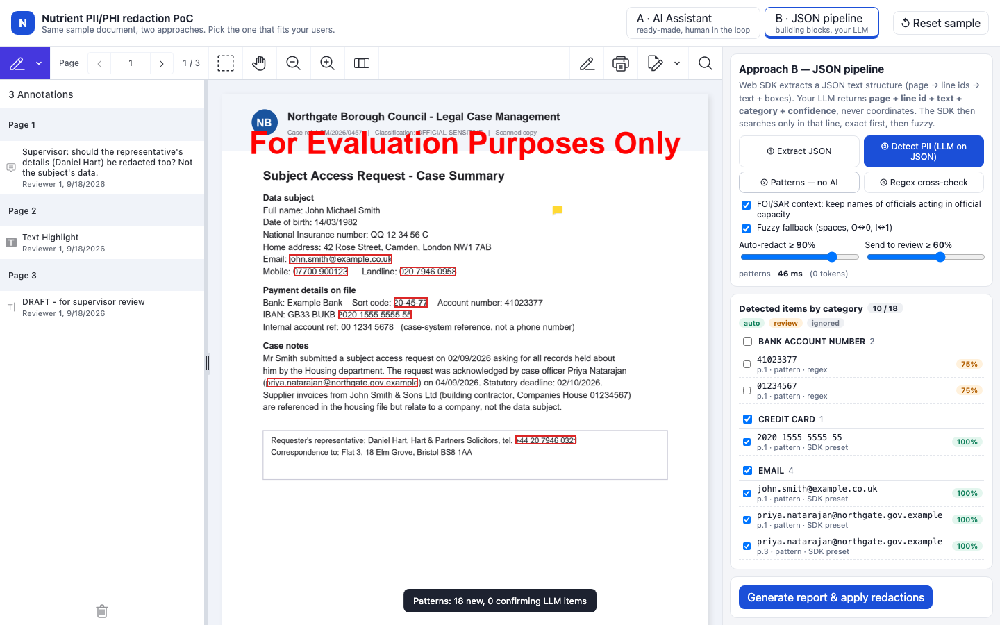
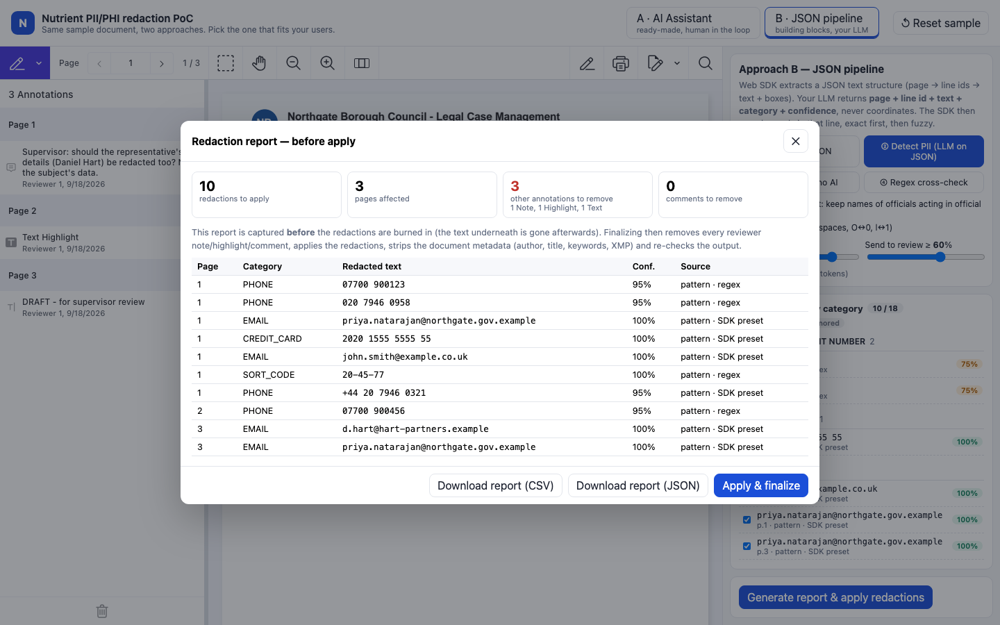
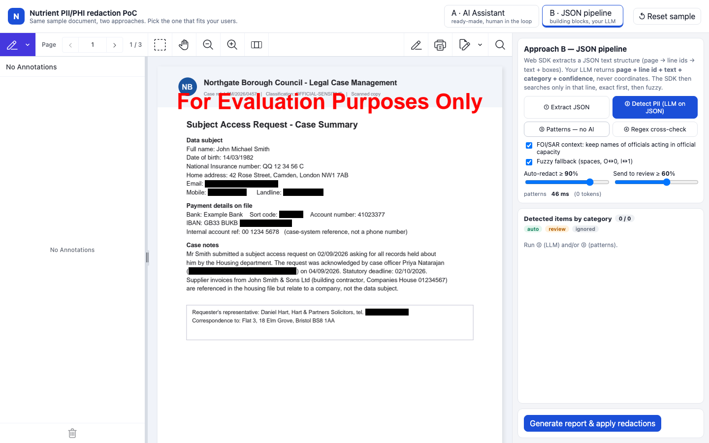

# Nutrient PII Redaction

A Nutrient.io demo that finds personal and health data (PII/PHI) in a PDF, marks it for redaction, lets a reviewer check each item, then burns in the redactions and produces a report.



One web page shows two approaches on the same sample document:

1. **A · AI Assistant.** Nutrient AI Assistant runs as a chat and agent inside the Nutrient Web SDK viewer, using your LLM. A redaction skill tells it what to look for. It searches the real text layer and creates one redaction annotation per occurrence, then answers with a table (page, category, text, confidence).
2. **B · JSON pipeline.** The Web SDK extracts a JSON text structure (pages, line ids, text). Only ids and text go to your LLM, which returns page, line id, exact text, category and confidence, never coordinates. The SDK then searches only in that line: exact first, then fuzzy (spaces, O↔0, l↔1).
   - Two sliders set the thresholds: auto-redact at X % or more, send to review at Y % or more, ignore below.
   - **Patterns — no AI** adds deterministic matches (SDK presets and UK regexes) at zero token cost.
   - **Regex cross-check** runs the regexes on the extracted text and lists anything not covered by a redaction.
3. **Finalize.** Both approaches share the **Generate report & apply redactions** button:
   - The report (page, category, redacted text, confidence, source) is built before the redactions are burned in. Download it as CSV or JSON.
   - Reviewer notes, highlights, free text and comments are deleted through the Web SDK API.
   - `applyRedactions()` runs, then the server strips the document metadata (title, author, keywords, XMP).
   - The output is reloaded and checked: no redacted string left in the text layer, no annotation left.

| | **A · AI Assistant** | **B · JSON pipeline** |
|---|---|---|
| Who finds the PII | AI Assistant (agent and chat in the viewer), using your LLM | Your LLM, fed a JSON text structure built by the Web SDK |
| What the LLM returns | Redaction annotations, created in the viewer | Page, line id, exact text, category and confidence |
| How redactions are placed | AI Assistant text search tools on the real text layer | SDK search limited to that page and line, exact then fuzzy |
| Confidence | Per item in the chat table; the skill only marks items at 90 % or more | Two sliders |
| No-AI option | None | SDK presets and UK regexes (0 tokens) |
| Effort to integrate | Ready-made component | Building blocks you wire into your own workflow |

The only external service is the OpenAI API, used by AI Assistant and by the detection endpoint.

## Prerequisites

- Node.js 20 or later and npm
- Docker with docker compose v2.24 or later (runs AI Assistant and its database for approach A)
- An OpenAI API key

## Environment variables

`npm run setup` (part of `npm run demo`) creates `.env` from `.env.example` when it is missing. Keys are only read from `.env` or the environment, never from code.

| Variable | Purpose | Default |
|---|---|---|
| `OPENAI_API_KEY` | OpenAI API key for AI Assistant (A) and `/api/detect` (B) | required |
| `OPENAI_MODEL` | Model used by approach B | `gpt-4.1-mini` |
| `NUTRIENT_WEB_LICENSE_KEY` | Nutrient Web SDK license key, served to the browser by `GET /api/config` | empty = evaluation mode (watermark) |
| `AIA_ACTIVATION_KEY` | Nutrient AI Assistant activation key | empty = evaluation mode (1 hour per container start) |
| `PORT` | Port of the web server | `4810` |
| `AIA_URL` | AI Assistant URL | `http://localhost:4100` |
| `AIA_DB_PASSWORD` | Password of the AI Assistant database | `change-me` |
| `AIA_API_AUTH_TOKEN` | AI Assistant API token | `change-me` |
| `AIA_DASHBOARD_PASSWORD` | AI Assistant dashboard password (user `dashboard`) | `change-me` |
| `AIA_SECRET_KEY_BASE` | AI Assistant secret key base | empty = random at every start |

The `AIA_*` passwords are local-only defaults. Change them before you run the demo anywhere other than your own machine.

## Build and run

```bash
npm install
```

```bash
cp .env.example .env
```

Edit `.env` and set `OPENAI_API_KEY`.

```bash
npm run demo
```

Open <http://localhost:4810>.

`npm run demo` works the same on Windows, macOS and Linux (`./start.sh` is a macOS and Linux shortcut). It:

1. generates an RSA key pair in `keys/` to sign the AI Assistant JWTs,
2. writes `aia/.env` for docker compose (and `aia/license.env` when `AIA_ACTIVATION_KEY` is set),
3. generates the sample document if it is missing,
4. starts AI Assistant and its database in Docker (port 4100), waits for it, then starts the web server (port 4810).

Stop the containers:

```bash
npm run stop
```

Without an activation key, AI Assistant runs a 1-hour evaluation from each container start. Run `npm run demo` again to start a new hour.

The Web SDK comes from the `@nutrient-sdk/viewer` npm package and is served from `node_modules` at `/vendor`.

### Sample document

`public/docs/sample-case-file.pdf` is generated by `scripts/make-sample.mjs` with pdf-lib. All names, organisations and personal data in it are fictitious. To generate it again:

```bash
npm run sample
```

It tests:

- The same value on several pages, with different confidence per page.
- Messy OCR on page 2: `J0hn`, `14/O3/1982`, `j ohn.smith @example.co.uk`, `O77OO 9OO123`, `41O23377`.
- Look-alikes that are not personal data: `00 1234 5678` (a reference formatted like a phone number), `John Smith & Sons Ltd`, "rose bed", system codes.
- Health data (PHI): NHS number, diagnoses, GP details.
- FOI context: the council officer's name is kept (checkbox in B, skill rule in A).
- A reviewer sticky note, a highlight with a comment, a "DRAFT" free text and document metadata: all removed by the finalize step.
- A drawn signature on page 3. Text-based detection cannot see it; it needs an area redaction or a vision step.

## Using the app

1. **A · AI Assistant.** Click one of the suggested prompts to copy it, paste it in the chat and send. The assistant creates one redaction per occurrence and answers with a table. The list on the right jumps to each redaction. Tick **Ask me before every write action** to approve each step of the agent.
2. **B · JSON pipeline.**
   1. **Extract JSON** shows what the SDK extracts and what is sent to the LLM (ids and text only).
   2. **Detect PII** sends it to the LLM and places each result on its page and line. Results are grouped by category, with checkboxes and confidence.
   3. **Patterns — no AI** adds deterministic matches (email, phone, sort code, NI number, IBAN and more).
   4. **Regex cross-check** lists any regex match not covered by a redaction.
3. Click **Generate report & apply redactions**, download the report, then download the redacted PDF.
4. **Reset sample** reloads the original document in both viewers.

The report is built before the redactions are burned in:



After **Apply & finalize**, the viewer shows the redacted output, without reviewer annotations or metadata:



The screenshots use approach B with **Patterns — no AI** and the Web SDK in evaluation mode, hence the watermark.

## API

| Method and path | Description |
|---|---|
| `GET /api/config` | `{ licenseKey, aia: { up, backendUrl, jwt, sessionId }, llm: { model, configured } }` |
| `POST /api/detect` | JSON `{ document, foi, instructions }`, where `document` is the extracted text structure. Returns `{ entities, usage, model, ms }`; each entity has `category`, `text`, `page`, `lineId`, `confidence`, `subjectData` and `reason` |
| `POST /api/scrub` | Body: the redacted PDF (`application/pdf`). Returns the PDF without the Info dictionary, XMP metadata and annotations; header `X-Scrub-Report` lists what was removed |

## Where to look in the code

- `public/app.js`: everything in the browser. The AI Assistant configuration and its redaction skill (`AIA_SKILL`), the JSON extraction (`extractJson`), placing LLM results (`locate`), patterns, cross-check, and the finalize step (`finalize`, `applyFinal`).
- `server.js`: `/api/detect` (LLM call with the detection prompt and JSON schema), `/api/scrub` (metadata removal), `/api/config` (AI Assistant JWT).
- `aia/docker-compose.yml`: AI Assistant and its database.
- `scripts/make-sample.mjs`: generates the sample document.

## Notes

- **Azure:** AI Assistant can use Azure OpenAI instead of OpenAI (service configuration). In approach B, the LLM call is a single function in `server.js` that can point to another model or PII service.
- **Scanned documents:** this demo uses the PDF text layer. For scans, the same JSON structure can come from Nutrient OCR or ICR extraction, with the rest of the pipeline unchanged.
- **Web SDK 1.24:** do not set `showAIAssistant: true` in `initialViewState`. The chat then starts before the PDF engine and never connects. The demo opens the chat right after the document loads instead.
